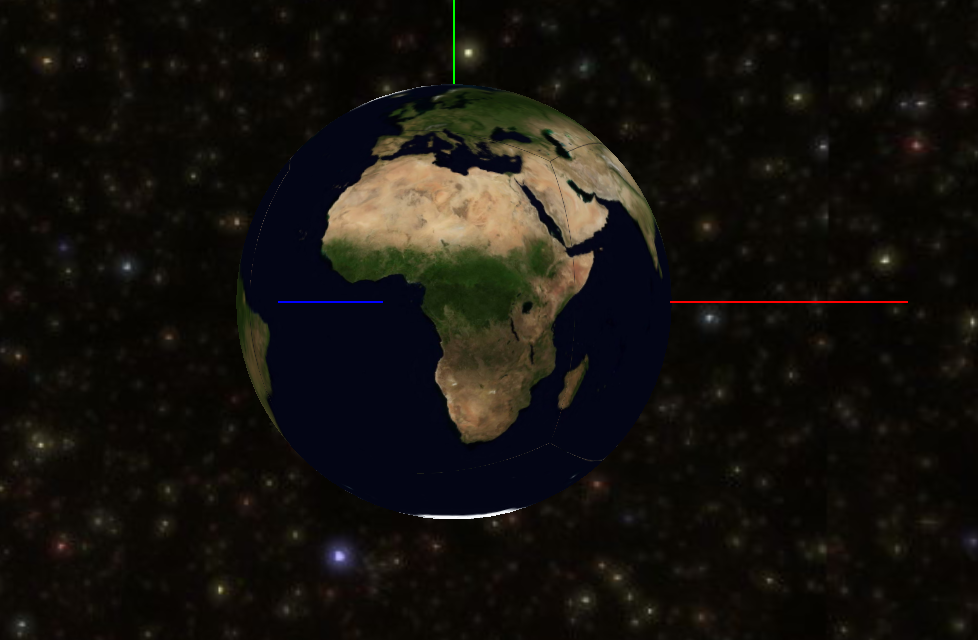
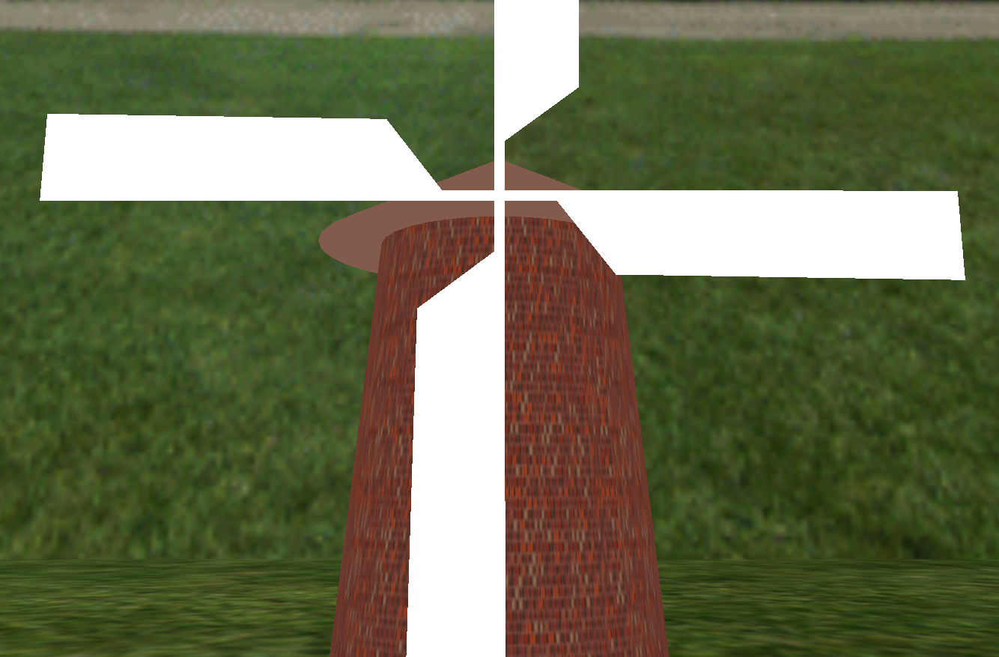
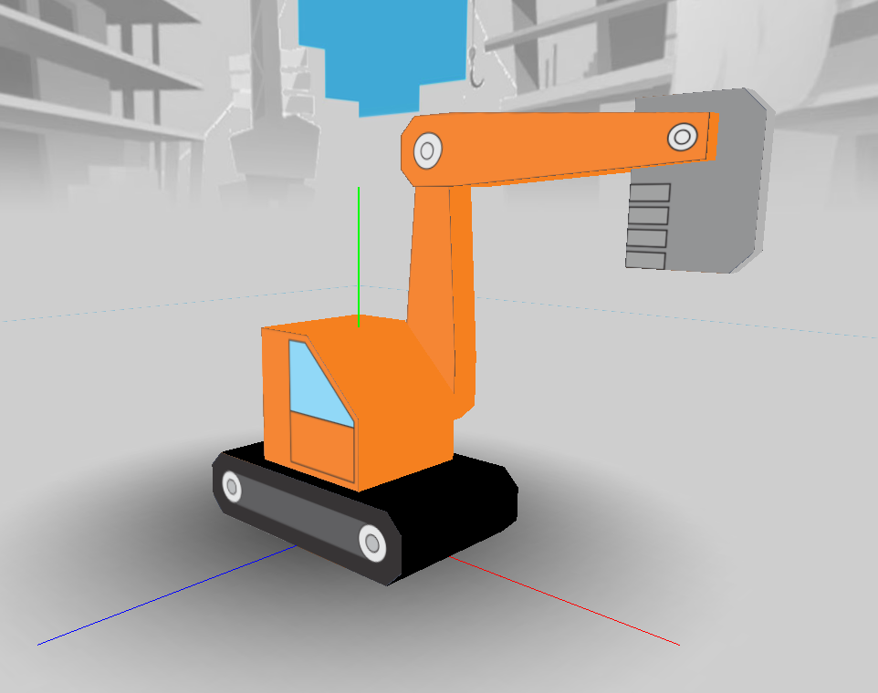
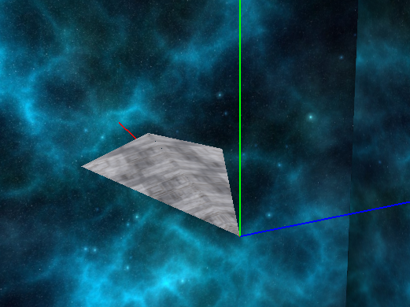
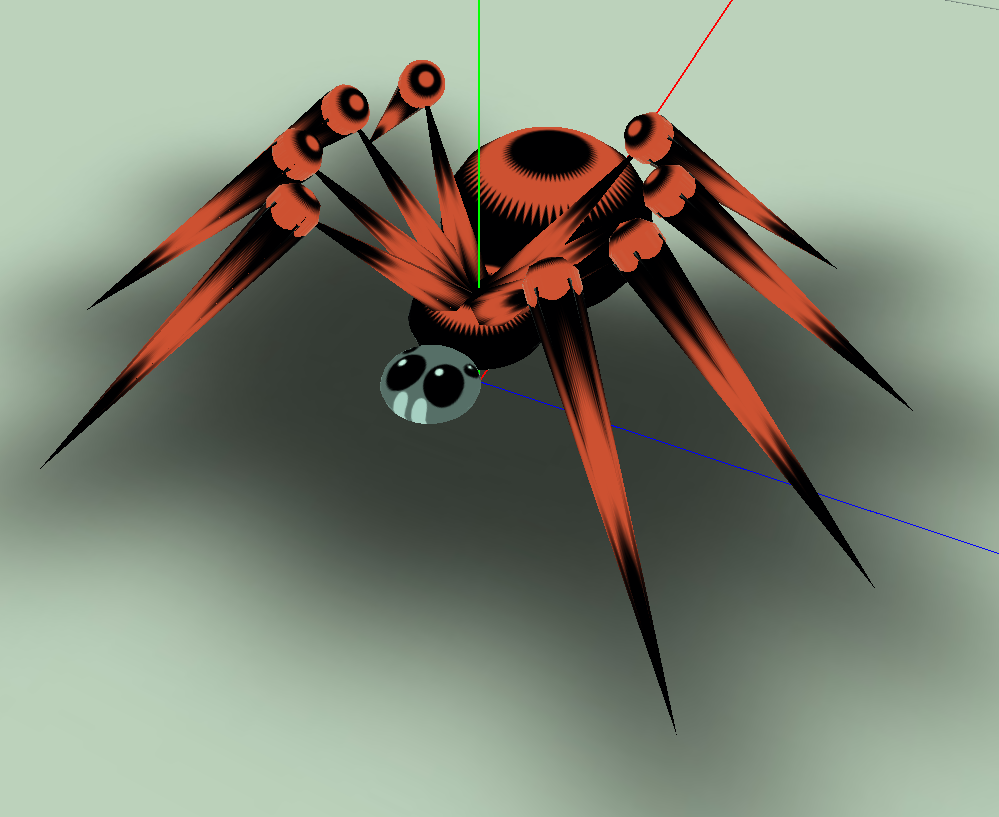

# OpenGL and MFC Graphics Projects

This repository contains a collection of Windows-based C++ graphics projects developed using OpenGL, MFC, and Win32 APIs. The projects were created as academic/faculty assignments and demonstrate real-time rendering, scene composition, camera control, textured environment mapping, and basic 3D visualization techniques.

## Project Overview

These applications are implemented as classic desktop graphics programs for Microsoft Windows. Each project includes a Visual Studio solution and project files, with rendering logic built around OpenGL and its utility libraries.

## Repository Contents

The repository includes multiple independent projects, each representing a different rendering or visualization exercise:

- 2015-Planeta/ — planetary / 3D scene visualization project
- 2016-Vetrenjaca/ — environment or windmill-style rendering project
- 2018-Svemirac/ — space-themed graphics project
- 2019-Bager/ — geometry and rendering-related project
- 2020-Pauk/ — 3D model or object visualization project

Each project folder contains its own Visual Studio solution (.sln) and project configuration (.vcxproj).

## Controls by Project

| Project | Controls | Description |
|---|---|---|
| 2015-Planeta | Arrow keys, `+`, `-`, `Q`, `E` | Rotate camera, adjust distance, and modify the secondary orbital object angle |
| 2016-Vetrenjaca | Arrow keys, `Q` | Rotate camera and change the windmill angle |
| 2018-Svemirac | Arrow keys, `Z`, `X` | Rotate the camera and zoom in/out |
| 2019-Bager | Arrow keys, `Z`, `X`, `1`-`8` | Rotate camera, zoom, and animate or rotate different parts of the model |
| 2020-Pauk | Arrow keys, `+`, `-` | Change viewing angle and zoom |

### 2015-Planeta
- `LEFT` / `RIGHT`: rotate camera left or right
- `UP` / `DOWN`: adjust viewing elevation
- `+` / `-`: change scene distance from the camera
- `Q` / `E`: rotate the moon or secondary object

### 2016-Vetrenjaca
- `LEFT` / `RIGHT`: rotate view horizontally
- `UP` / `DOWN`: move camera vertically
- `Q`: rotate the windmill mechanism

### 2018-Svemirac
- `LEFT` / `RIGHT`: rotate camera around the scene
- `UP` / `DOWN`: change pitch/elevation
- `Z`: zoom in / reduce distance
- `X`: zoom out / increase distance

### 2019-Bager
- `LEFT` / `RIGHT`: orbit camera around the object
- `UP` / `DOWN`: tilt camera
- `Z`: decrease view distance
- `X`: increase view distance
- `1`-`8`: rotate different mechanical parts or components

### 2020-Pauk
- `UP` / `DOWN`: change vertical viewing angle
- `LEFT` / `RIGHT`: rotate camera around the scene
- `+` / `-`: zoom in/out

## Tech Stack

- C++
- Microsoft Foundation Classes (MFC)
- Win32 API
- OpenGL
- GLU
- GLUT
- Visual Studio / MSBuild

## Typical Project Structure

```text
GLK/
├── GLK.sln
├── GLK/
│   ├── GL/
│   ├── res/
│   ├── GLK.cpp
│   ├── GLK.h
│   ├── GLRenderer.cpp
│   ├── GLRenderer.h
│   ├── GLKView.cpp
│   ├── MainFrm.cpp
│   ├── stdafx.h
│   └── ReadMe.txt
└── ...
```

## Screenshots

The following screenshots are expected in the repository root using the naming convention below:

- `2015.PNG`
- `2016.PNG`
- `2018.PNG`
- `2019.PNG`
- `2020.PNG`

### Project Gallery











```text
OpenGL/
├── 2015.PNG
├── 2016.PNG
├── 2018.PNG
├── 2019.PNG
├── 2020.PNG
├── README.md
└── ...
```

## Build and Run

1. Open the relevant .sln file in Visual Studio.
2. Select the target configuration (Debug or Release).
3. Set the platform to Win32.
4. Build the solution.
5. Run the application.

> These projects are designed for the Windows platform and rely on older MFC/OpenGL patterns, so compatibility with newer toolchains may require adjustments depending on the environment.

## Compatibility Notes

This repository contains legacy academic and training projects built for older Windows development environments. Some files may require specific Visual Studio versions, Windows SDK settings, or compatibility adjustments when compiled on modern systems.

## Summary

This project set reflects a classic Windows graphics development workflow using C++ and OpenGL, with MFC as the application framework and real-time rendering logic implemented directly in native code. It is representative of early desktop 3D graphics practice and demonstrates fundamental graphics programming concepts in a Windows environment.
